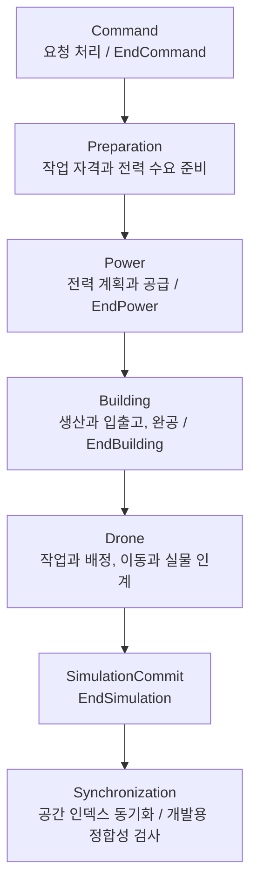

# Planet Miner

행성의 자원을 채굴하고 생산 설비, 컨베이어 벨트, 드론과 전력망을 연결해 공장을 확장하는 2D 자동화 공장 게임입니다. Unity와 C#으로 개발하는 개인 프로젝트이며, 다수의 설비와 아이템이 함께 동작하는 시뮬레이션을 Unity Entities(ECS)로 구성합니다.

현재는 공개 프리알파의 게임 규칙을 **Architecture V2**로 이식하고 있습니다. 상태를 변경하는 시스템의 책임과 처리 순서, 결과가 다른 시스템에 보이는 시점을 명시하는 데 중점을 두고 있습니다.

> 구현 상태 확인 기준: **2026-10-20 / [architecture-v2](https://github.com/Gentlet/planet-miner/tree/architecture-v2)**. 아래 기능 설명과 코드/문서 링크는 이 개발 브랜치를 기준으로 합니다.

## 영상과 공개 데모

[](https://youtu.be/gT6n4E4vvvY)

[YouTube 데모 영상](https://youtu.be/gT6n4E4vvvY) / [Windows 프리알파 릴리스](https://github.com/Gentlet/planet-miner/releases/tag/v0.1.0-pre-alpha)

영상과 Windows 데모는 노션 포트폴리오에 소개된 **`v0.1.0-pre-alpha` / `3517eeb` / 2026-09-05** 버전입니다. 이전 버전의 플레이 흐름을 보여주며, 현재 V2의 구현 상태와는 구분합니다.

## 현재 구현 상태

### V2 코드에 구현된 기능

아래의 '구현'은 현재 소스에 해당 처리 경로가 존재한다는 뜻입니다. 실제 플레이에 필요한 입력과 화면 연결, 드론 수행부는 후속 작업으로 남아 있습니다.

| 영역 | 구현 범위 |
| --- | --- |
| 아이템과 저장 | 아이템별 ECS 엔티티, 월드/보관 소유권 전환, 생성과 소멸, 슬롯별 품목과 스택 한도에 따른 입출고를 처리합니다. |
| 벨트와 라우팅 | 아이템 이동 판단과 실행, 벨트 종단 처리, 건물 입출고, 분배기/합류기의 포트 선택과 목적지 경합 중재를 처리합니다. |
| 채굴 | 건물 점유 영역의 자원을 선택하고 전력 공급에 따라 채굴을 진행합니다. 생산 결과와 매장량 차감, 유한 자원의 고갈을 처리합니다. |
| 제작 | 레시피 선택/변경, 재료별 입력 슬롯, 제작 시작 시 재료 소비, 전력에 따른 진행, 주생산품과 다중 부산물 출력을 처리합니다. |
| 월드 생성 | 초기 청크 요청, 중복 생성 방지, 시드 기반 자원 생성과 바닥 바이옴/변형 선택을 구현했습니다. 바닥은 개발용 색상 프리뷰로 확인하는 단계입니다. |
| 배치와 건설 | 회전한 건물 크기와 점유/자원 조건을 검증하고 공사 현장과 자재 요구를 생성합니다. 실제 자재 도착과 방해물 회수가 충족되면 완공 건물을 생성합니다. |
| 취소와 철거 | 현장 취소 시 도착한 자재를 반환합니다. 건물 철거 시 보관품/생산품 반환과 설정상 건축 비용 환급을 처리합니다. |
| 전력 | 전신주 연결 기반 전력망 구성, 망별 수요와 발전 예산 배분, 석탄 연료 소비, 건물별 공급 결과 게시와 채굴/제작 연동을 처리합니다. |
| 드론 물류 관리 | 건설 자재 공급과 월드 아이템 회수 작업의 생성/배정/예약/재배정을 처리합니다. 외부 행동 신호를 받아 실물을 인계하고 성공한 수량만 도착량과 예약에 반영합니다. |

### 개발 중 / 후속 구현

| 영역 | 남은 작업 |
| --- | --- |
| 드론의 실제 행동 | 수행자 생성/등록, 이동, 경로 평가, 위치 관측과 행동 신호 생성을 연결해야 합니다. 현재 작업 관리와 아이템 인계 처리만으로 자율 운송이 완성되지는 않습니다. |
| 드론 정거장과 충전 | 수납/귀환/충전 정책을 실제 시스템으로 구현하고 초기 적재량과 연구에 따른 능력 변경을 연결해야 합니다. |
| 연구 | 현재 배치는 설정된 해금 여부를 검사합니다. 연구 진행과 완료에 따른 해금 상태 갱신은 후속입니다. |
| 게임 시작과 조작 | 주 시설 자동 생성, 플레이어 입력, 카메라 조작, 건설/선택 화면과 UI Toolkit 컨트롤러를 V2에 연결해야 합니다. |
| 바닥 렌더링 | 바이옴 선택과 진단용 프리뷰를 실제 바닥 청크 렌더러로 연결해야 합니다. |
| V2 통합 검증 | 통합 플레이, Player 빌드와 성능 검증이 후속 범위입니다. 기존 프리알파 영상과 개별 시스템 검증을 V2 전체의 플레이 검증으로 간주하지 않습니다. |

## Architecture V2

### 상태 변경 책임과 처리 순서

Initialization에서 설정과 프리팹 DB, 초기 청크 요청을 준비한 뒤 게임 시뮬레이션을 시작합니다. 한 틱의 기본 실행 순서는 다음과 같습니다.



전력, 건물, 드론 도메인은 각각 `Decision → Reservation → Execution → StateApply` 순서로 판단, 경합 중재, 실행, 상태 반영을 나눕니다. 엔티티 생성/삭제 같은 구조 변경은 각 도메인의 종료 ECB(Entity Command Buffer)에서 확정합니다.

- **건물 결과를 드론 입력으로 사용:** 건물과 일반 아이템의 구조 변경은 `EndBuilding`에서 확정되어 같은 틱의 드론 처리에 보입니다.
- **새 작업의 사용 시점 고정:** 드론 작업/경로/배정과 행동 결과는 `EndSimulation`에서 공개합니다. 새 작업과 배정, 경로는 다음 틱부터 사용합니다.
- **완공 판단 시점 고정:** 완공은 건물 단계 마지막에 판단합니다. 이번 틱 드론의 마지막 납품은 다음 틱의 완공 판단에 반영됩니다.

실제 그룹과 순서는 [Phases](https://github.com/Gentlet/planet-miner/tree/architecture-v2/Assets/Scripts/Phases)에서 확인할 수 있습니다.

### 아이템 소유권과 조회용 데이터

아이템 하나는 엔티티 하나로 관리합니다. `ItemOwnership.Owner`가 원본 소유 상태이며, 소유자의 보관 버퍼와 함께 갱신합니다. 드론 작업 배정과 실제 인계를 구분하고, 실제 인계에 성공한 수량으로 도착량과 예약을 정산합니다.

격자 위치와 소유권 같은 ECS 상태를 원본으로 두고 공간 인덱스는 조회용으로 재구축합니다. 공유 인덱스를 읽고 쓰는 Job은 Fence에 의존성을 등록하여 인덱스 갱신과 읽기가 충돌하지 않도록 처리합니다. 벨트 이동과 생산 등에는 `ISystem`, Job System과 Burst를 사용합니다.

## 개발 환경과 실행

현재 저장소의 버전 설정은 다음과 같습니다.

| 항목 | 버전 / 구성 |
| --- | --- |
| Unity Editor | `6000.4.11f1` |
| 언어 | C# |
| ECS | Unity Entities `6.4.0` / Entities Graphics `6.4.0` |
| 작업 처리 | Job System / Burst `1.8.29` |
| 렌더링 | Universal Render Pipeline `17.4.0` |

최신 버전 값은 [ProjectVersion.txt](https://github.com/Gentlet/planet-miner/blob/architecture-v2/ProjectSettings/ProjectVersion.txt)와 [packages-lock.json](https://github.com/Gentlet/planet-miner/blob/architecture-v2/Packages/packages-lock.json)을 확인합니다.

1. Git과 Git LFS를 설치한 뒤 V2 개발 브랜치를 내려받습니다. 이미지 등 바이너리 에셋은 Git LFS로 관리합니다.

   ```sh
   git lfs install
   git clone --branch architecture-v2 https://github.com/Gentlet/planet-miner.git
   ```

2. Unity Hub에서 내려받은 프로젝트 폴더를 추가하고 위 Unity 버전으로 엽니다.
3. 패키지 가져오기와 컴파일이 끝나면 `Assets/Scenes/V2 Test Scene.unity`를 엽니다.
4. Play Mode Start Scene도 이 메인 장면으로 지정합니다. `Assets/Scenes/V2 Test Scene/sub.unity`는 메인 장면에서 자동 로드하며 건물/아이템/자원 프리팹 DB를 제공합니다.

현재 진입 장면은 **V2 개발/진단용 장면**입니다. 공개 프리알파의 조작과 UI를 그대로 이용하는 단계는 아니며, 플레이 가능한 이전 버전은 위 Windows 릴리스에서 확인할 수 있습니다.

## 코드와 문서

### 주요 코드 진입점

| 확인할 내용 | 경로 |
| --- | --- |
| 데이터 정의와 요청/결정/결과 | [Assets/Scripts/Components](https://github.com/Gentlet/planet-miner/tree/architecture-v2/Assets/Scripts/Components) |
| 채굴/제작과 벨트/저장 처리 | [Assets/Scripts/Systems/Buildings](https://github.com/Gentlet/planet-miner/tree/architecture-v2/Assets/Scripts/Systems/Buildings) |
| 배치 승인과 현장 생성 | [BuildingPlacementCommandSystem.cs](https://github.com/Gentlet/planet-miner/blob/architecture-v2/Assets/Scripts/Systems/Command/BuildingPlacementCommandSystem.cs) |
| 자재 도착과 완공 | [ConstructionLifecycleApplySystem.cs](https://github.com/Gentlet/planet-miner/blob/architecture-v2/Assets/Scripts/Systems/Construction/StateApply/ConstructionLifecycleApplySystem.cs) |
| 전력 계획과 공급 | [Assets/Scripts/Systems/Power](https://github.com/Gentlet/planet-miner/tree/architecture-v2/Assets/Scripts/Systems/Power) |
| 드론 작업/예약/이동/인계 | [Assets/Scripts/Systems/Drones](https://github.com/Gentlet/planet-miner/tree/architecture-v2/Assets/Scripts/Systems/Drones) |
| 공간 인덱스 동기화 | [Assets/Scripts/Systems/Synchronization](https://github.com/Gentlet/planet-miner/tree/architecture-v2/Assets/Scripts/Systems/Synchronization) |
| EditMode 테스트 | [Assets/Editor/Tests](https://github.com/Gentlet/planet-miner/tree/architecture-v2/Assets/Editor/Tests) |

### 상세 문서

- [문서 안내](https://github.com/Gentlet/planet-miner/blob/architecture-v2/Docs/README.md)
- [현재 실행 순서와 소유권 규칙](https://github.com/Gentlet/planet-miner/blob/architecture-v2/AGENTS.md)
- [ECS 컴포넌트 색인](https://github.com/Gentlet/planet-miner/blob/architecture-v2/Docs/CodeMemory/Components/README.md)
- [전력망 명세](https://github.com/Gentlet/planet-miner/blob/architecture-v2/Docs/Specifications/PowerGrid.md)
- [건설과 드론 공급 명세](https://github.com/Gentlet/planet-miner/blob/architecture-v2/Docs/Specifications/ConstructionAndDroneSupply.md)
- [드론 Lifecycle 설계](https://github.com/Gentlet/planet-miner/blob/architecture-v2/Docs/Specifications/DroneLifecycle.md)
- [드론 이동/배터리/도착 계약](https://github.com/Gentlet/planet-miner/blob/architecture-v2/Docs/Specifications/DroneMovement.md)

테스트 코드는 개별 시스템과 핵심 흐름, 결함 회귀를 확인하기 위한 자료입니다. 컴파일/선택 EditMode 테스트 결과와 실제 플레이, 시각 결과, Player 빌드, 성능 검증은 각각 구분해 관리합니다.
