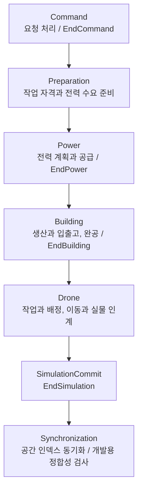

# Planet Miner

행성의 자원을 채굴하고 생산 설비, 컨베이어 벨트, 드론과 전력망을 연결해 공장을 확장하는 2D 자동화 공장 게임입니다. Unity와 C#으로 개발하는 개인 프로젝트이며, 다수의 설비와 아이템이 함께 동작하는 시뮬레이션을 Unity Entities(ECS)로 구성합니다.

현재는 공개 프리알파의 게임 규칙을 **Architecture V2**로 이식하고 있습니다. 상태를 변경하는 시스템의 책임과 처리 순서, 결과가 다른 시스템에 보이는 시점을 명시하는 데 중점을 두고 있습니다.

아래 구현 상태와 코드 링크는 [architecture-v2 개발 브랜치](https://github.com/Gentlet/planet-miner/tree/architecture-v2)를 기준으로 합니다.

## 영상과 공개 데모

[](https://youtu.be/gT6n4E4vvvY)

[YouTube 데모 영상](https://youtu.be/gT6n4E4vvvY) / [Windows 프리알파 릴리스](https://github.com/Gentlet/planet-miner/releases/tag/v0.1.0-pre-alpha)

영상과 Windows 데모는 노션 포트폴리오에 소개된 **`v0.1.0-pre-alpha` / `3517eeb` / 2026-09-05** 버전입니다. 이전 버전의 플레이 흐름을 보여주며, 현재 V2의 구현 상태와는 구분합니다.

## 현재 구현 상태

### V2 코드에 구현된 기능

| 영역 | 구현 범위 |
| --- | --- |
| 아이템과 보관 | 바닥과 벨트 위의 아이템은 ECS 엔티티로 관리합니다. 보관과 생산품은 슬롯별 품목과 수량으로, 드론 화물은 수행자별 품목과 수량으로 관리합니다. |
| 벨트와 라우팅 | 아이템 이동 판단과 실행, 벨트 종단 처리, 건물 입출고, 분배기/합류기의 포트 선택과 목적지 경합 중재를 처리합니다. |
| 채굴 | 건물 점유 영역의 자원을 선택하고 전력 공급에 따라 채굴을 진행합니다. 생산 결과와 매장량 차감, 유한 자원의 고갈을 처리합니다. |
| 제작 | 레시피 선택/변경, 재료별 입력 슬롯, 제작 시작 시 재료 소비, 전력에 따른 진행, 주생산품과 다중 부산물 출력을 처리합니다. |
| 월드 생성 | 초기 청크 요청, 중복 생성 방지, 시드 기반 자원 생성, 바이옴과 변형에 따른 바닥 스프라이트를 처리합니다. |
| 배치와 건설 | 회전한 건물 크기와 점유/자원 조건을 검증하고 공사 현장과 자재 요구를 생성합니다. 실제 자재 도착과 방해물 회수가 충족되면 완공 건물을 생성합니다. |
| 취소와 철거 | 현장 취소 시 도착한 자재를 반환합니다. 건물 철거 시 보관품/생산품 반환과 설정상 건축 비용 환급을 처리합니다. |
| 전력 | 전신주 기반 전력망, 발전 연료 소비, 건물별 공급과 채굴/제작/충전 연동을 처리합니다. 전신주를 선택하면 전력망 수치와 해당 전신주에 연결된 발전 설비를 표시합니다. |
| 드론 물류 | 작업 배정, 경로 평가, 이동, 자재 수집과 납품을 처리합니다. 드론은 정거장에서 충전하고 완충 뒤 전용 슬롯에 수납됩니다. 정거장 철거 시 다른 정거장의 수납 수량을 예약해 이관합니다. |
| 연구 | 재료와 전력을 사용해 진행하며, 완료 보상에 따라 건물 해금과 드론 능력치를 갱신합니다. |
| 시작과 저장 | 시작 화면의 새 게임과 이어하기, 주 시설 초기 배치, 카메라 조작, 건설 도구와 건물 상세 패널을 연결했습니다. 월드와 진행 중인 드론 작업을 수동 슬롯에 저장합니다. |

### 개발 중 / 후속 구현

실제 조작을 포함한 장시간 통합 플레이 검증이 남아 있습니다.

### 저장 호환성

현재 바이너리 저장은 **스키마 4**를 사용합니다. 스키마 1~3 저장에서는 이어하기를 사용할 수 없습니다. 새 게임에서 기존 슬롯을 덮어쓰려면 게임 안에서 교체를 확인해야 합니다.

### Windows Player 부하 측정

2026년 11월, 당시 최적화의 전후 비교를 위해 V2 테스트 장면에 드론 500기를 배치하고 Windows Release Player에서 같은 부하를 각각 3회 실행해 프레임 시간을 측정했습니다.

## Architecture V2

### 상태 변경 책임과 처리 순서

Initialization에서 설정과 프리팹 DB, 초기 청크 요청을 준비한 뒤 게임 시뮬레이션을 시작합니다. 한 틱의 기본 실행 순서는 다음과 같습니다.



전력, 건물, 드론 도메인은 각각 `Decision → Reservation → Execution → StateApply` 순서로 판단, 경합 중재, 실행, 상태 반영을 나눕니다. 엔티티 생성/삭제 같은 구조 변경은 각 도메인의 종료 ECB(Entity Command Buffer)에서 확정합니다.

- **건물 결과를 드론 입력으로 사용:** 건물과 일반 아이템의 구조 변경은 `EndBuilding`에서 확정되어 같은 틱의 드론 처리에 보입니다.
- **새 작업의 사용 시점 고정:** 드론 작업/경로/배정과 행동 결과는 `EndSimulation`에서 공개합니다. 새 작업과 배정, 경로는 다음 틱부터 사용합니다.
- **완공 판단 시점 고정:** 완공은 건물 단계 마지막에 판단합니다. 이번 틱 드론의 마지막 납품은 다음 틱의 완공 판단에 반영됩니다.

실제 그룹과 순서는 [Phases](https://github.com/Gentlet/planet-miner/tree/architecture-v2/Assets/Scripts/Phases)에서 확인할 수 있습니다.

### 아이템 소유권과 조회용 데이터

바닥과 벨트 위의 아이템은 엔티티이며, 건물 보관·생산품과 드론 화물은 수량을 원본으로 사용합니다. 드론 작업은 실제 인계에 성공한 수량으로 도착량과 예약을 정산합니다. 작업이 취소되면 남은 예약을 반환하고 이미 실은 화물을 보존합니다. 화물은 목적지를 다시 배정하거나 안전한 위치에 방출해 회수할 수 있습니다. 정거장 철거는 전원 수납 공간을 확보하고 실제 이관이 끝난 뒤 확정합니다.

격자 위치와 소유권 같은 ECS 상태를 원본으로 두고 공간 인덱스는 조회용으로 재구축합니다. 공유 인덱스를 읽고 쓰는 Job은 Fence에 의존성을 등록하여 인덱스 갱신과 읽기가 충돌하지 않도록 처리합니다. 벨트 이동과 생산 등에는 `ISystem`, Job System과 Burst를 사용합니다.

## 개발 환경과 실행

현재 저장소의 버전 설정은 다음과 같습니다.

| 항목 | 버전 / 구성 |
| --- | --- |
| Unity Editor | `6000.6.8f1` |
| 언어 | C# |
| ECS | Unity Entities `6.6.0` / Entities Graphics `6.6.0` |
| 작업 처리 | Job System / Burst `2.0.0` |
| 렌더링 | Universal Render Pipeline `17.6.0` |

최신 버전 값은 [ProjectVersion.txt](https://github.com/Gentlet/planet-miner/blob/architecture-v2/ProjectSettings/ProjectVersion.txt)와 [packages-lock.json](https://github.com/Gentlet/planet-miner/blob/architecture-v2/Packages/packages-lock.json)을 확인합니다.

1. Git과 Git LFS를 설치한 뒤 V2 개발 브랜치를 내려받습니다. 이미지 등 바이너리 에셋은 Git LFS로 관리합니다.

   ```sh
   git lfs install
   git clone --branch architecture-v2 https://github.com/Gentlet/planet-miner.git
   ```

2. Unity Hub에서 내려받은 프로젝트 폴더를 추가하고 위 Unity 버전으로 엽니다.
3. 패키지 가져오기와 컴파일이 끝나면 `Assets/Scenes/V2 Test Scene.unity`를 엽니다.
4. Play Mode Start Scene도 이 메인 장면으로 지정합니다. `Assets/Scenes/V2 Test Scene/sub.unity`는 메인 장면에서 자동 로드하며 건물/아이템/자원 프리팹 DB를 제공합니다.

현재 진입 장면은 **V2 Test Scene**입니다. 시작 화면에서 새 게임 또는 이어하기를 선택할 수 있습니다.

## 코드 구조

### 주요 코드 진입점

| 확인할 내용 | 경로 |
| --- | --- |
| 데이터 정의와 요청/결정/결과 | [Assets/Scripts/Components](https://github.com/Gentlet/planet-miner/tree/architecture-v2/Assets/Scripts/Components) |
| 채굴/제작과 벨트/저장 처리 | [Assets/Scripts/Systems/Buildings](https://github.com/Gentlet/planet-miner/tree/architecture-v2/Assets/Scripts/Systems/Buildings) |
| 배치 승인과 현장 생성 | [BuildingPlacementCommandSystem.cs](https://github.com/Gentlet/planet-miner/blob/architecture-v2/Assets/Scripts/Systems/Command/BuildingPlacementCommandSystem.cs) |
| 자재 도착과 완공 | [ConstructionLifecycleApplySystem.cs](https://github.com/Gentlet/planet-miner/blob/architecture-v2/Assets/Scripts/Systems/Construction/StateApply/ConstructionLifecycleApplySystem.cs) |
| 전력 계획과 공급 | [Assets/Scripts/Systems/Power](https://github.com/Gentlet/planet-miner/tree/architecture-v2/Assets/Scripts/Systems/Power) |
| 드론 작업/예약/이동/자동 픽업/납품/인계 | [Assets/Scripts/Systems/Drones](https://github.com/Gentlet/planet-miner/tree/architecture-v2/Assets/Scripts/Systems/Drones) |
| 공간 인덱스 동기화 | [Assets/Scripts/Systems/Synchronization](https://github.com/Gentlet/planet-miner/tree/architecture-v2/Assets/Scripts/Systems/Synchronization) |
